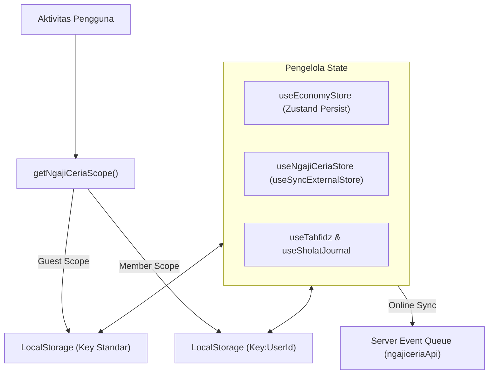

# Tartila (Ngaji Ceria) — Architecture & Development Guidelines
> **Single Source of Truth (SSOT)** untuk pengembangan antarmuka, gamifikasi, manajemen state, sistem audio, dan arsitektur kode pada platform Tartila.

---

## 1. Design System & UI/UX (Sticker / Neo-Brutalism)

Tartila mengadopsi bahasa visual **"Sticker Neo-Brutalism"** yang ceria, ramah anak, tegas, dan berenergi tinggi. Seluruh komponen visual menolak gaya *glassmorphism*, gradasi lembut (*soft/diffuse blur*), dan bayangan kabur transparan. Sebagai gantinya, antarmuka menggunakan **garis kontur pekat**, **hard shadow (bayangan solid tanpa blur)**, dan **warna-warna cerah berkontras tinggi**.

### 1.1 Design Tokens (Color Palette)

Palet warna utama berpusat pada **Emerald Oasis** (kombinasi hijau mint `#F0FDF4`, deep teal `#134E4A`, teal utama `#0D9488`, dan aksen coral ceria `#FF6B6B`).

| Token / Nama Warna | Hex Code | Peran / Penggunaan Utama |
| :--- | :--- | :--- |
| **Deep Teal (Contour)** | `#134E4A` | Garis tepi (*border*), bayangan (*hard shadow*), dan teks utama |
| **Mint Cloud (Background)** | `#F0FDF4` | Latar belakang dasar aplikasi (*oasis canvas*) |
| **Teal Emerald (Primary)** | `#0D9488` | Tombol aksi utama, aksen tombol aktif, badge progres |
| **Teal Dark** | `#0F766E` | Hover/active state dari elemen Teal |
| **Coral Glow (Accent)** | `#FF6B6B` | Aksen sekunder, tombol bahaya/salah, elemen hati/nyawa |
| **Coral Soft** | `#FFF0F0` | Latar kartu feedback salah, badge hati, container lembut |
| **Amber Gold (Warning)** | `#F59E0B` / `#D97706` | Bintang, reward, misi, streak api, tiket game |
| **Yellow Sunny** | `#FEF08A` / `#FEF3C7` | Latar badge aktif, sorotan, kartu pengingat kaidah |
| **Success Emerald** | `#16A34A` / `#15803D` | Feedback jawaban benar, status selesai, status tepat waktu |
| **Success Soft** | `#DCFCE7` / `#EAF5EA` | Background kartu jawaban benar & lab tajwid |
| **Sky Blue (Karaoke/Info)** | `#0284C7` | Sorotan tajwid, audio aktif, teks karaoke sinkronisasi |
| **Sky Soft** | `#E0F2FE` / `#BAE6FD` | Background kotak contoh tajwid, background kata aktif karaoke |
| **Purple Magic** | `#9333EA` / `#F3E8FF` | Gudang doa, kartu ajaib, elemen spiritual |
| **Surface Card** | `#FFFFFF` | Permukaan kartu utama (putih bersih) |

---

### 1.2 Standar Visual (Border, Shadow, & Radius)

Setiap elemen antarmuka yang dapat diinteraksi atau berfungsi sebagai kartu informasi **wajib** mengikuti aturan geometris berikut:

```
┌─────────────────────────────────────────────────────────┐
│  Card / Button Surface (Solid Color)                    │
│  border: 3px solid #134E4A                              │
│  border-radius: 16px (2xl)                              │
└─────────────────────────────────────────────────────────┘
   │
   └───► Hard Drop Shadow: 4px 4px 0px #134E4A (No blur!)
```

#### Aturan Ketebalan Garis (Border)
- **Kontur Kartu / Modal / Banner**: `border-[3px] border-[#134E4A]` (wajib konsisten).
- **Sub-elemen / Chip / Badge Kecil**: `border-2 border-[#134E4A]`.
- **Garis Pemisah Internal**: `border-t-2 border-[#134E4A]/10` atau `border-b-2 border-[#134E4A]/10`.

#### Aturan Hard Shadow
- **Kartu Utama & Tombol Primer**: `shadow-[4px_4px_0px_#134E4A]`.
- **Kartu Sekunder & Tombol Sedang**: `shadow-[3px_3px_0px_#134E4A]`.
- **Badge / Chip / Tombol Kecil**: `shadow-[2px_2px_0px_#134E4A]`.
- **Aksen Khusus**: Diperbolehkan menggunakan bayangan solid berwarna untuk elemen tematik (misal: `shadow-[4px_4px_0px_#FF6B6B]` atau `shadow-[4px_4px_0px_#0284C7]`).
- **State Tekan (Active Click)**:
  ```css
  active:translate-y-[2px] active:shadow-none
  ```
  Elemen memberikan umpan balik taktil seperti menekan tombol fisik stiker.

#### Aturan Border Radius
- **Layar Modal / Wrapper Bawah / Banner Hero**: `rounded-[28px]` atau `rounded-[32px]`.
- **Kartu Konten (Card Container)**: `rounded-2xl` (16px) atau `rounded-[24px]`.
- **Tombol & Input Field**: `rounded-xl` (12px) atau `rounded-2xl` (16px).
- **Pill / Chip / Avatar Status**: `rounded-full` atau `rounded-xl`.

---

### 1.3 Sistem Tipografi

| Kategori | Font Family | Kelas CSS Tailwind | Karakteristik & Kegunaan |
| :--- | :--- | :--- | :--- |
| **Heading / Judul** | `Gabarito`, `Bricolage Grotesque`, sans-serif | `font-display font-black` | Tebal, ekspresif, sedikit rapat (`tracking-[-0.01em]`) untuk memberi kesan stiker kokoh |
| **Body / Latin Teks** | `Plus Jakarta Sans`, sans-serif | `font-sans font-bold` / `font-semibold` | Bersih, sangat mudah dibaca anak-anak, `tracking-[0.02em]` untuk ukuran kecil agar tidak dempet |
| **Ayat / Teks Arab** | `Scheherazade New`, `Amiri`, serif | `font-arabic` | Harakat jelas, spasi baris longgar (`leading-[2.2]` s.d. `leading-[2.4]`) dengan `dir="rtl"` |

---

### 1.4 Animasi Standar (Framer Motion & Mascot)

#### 1. Umpan Balik Jawaban (Feedback Motion)
Didefinisikan dalam `feedbackMotion.ts`:
- **Jawaban Benar (`correct`)**:
  ```ts
  { scale: [1, 1.08, 1], transition: { duration: 0.4, ease: "easeOut" } }
  ```
- **Jawaban Salah (`wrong`)**:
  ```ts
  { x: [0, -7, 7, -6, 6, -3, 0], transition: { duration: 0.42, ease: "easeInOut" } }
  ```

#### 2. Bibi Mascot & Companion Event
Maskot Bibi (`BibiMascot` / `BibiCompanion`) merespons aksi anak secara dinamis lewat event kustom window:
```ts
// src/utils/bibiEvent.ts
export type BibiReactionType = "play" | "exit" | "success" | "error" | "click";
export const triggerBibiReaction = (reaction: BibiReactionType) => {
  if (typeof window !== "undefined") {
    window.dispatchEvent(new CustomEvent("bibi-react", { detail: reaction }));
  }
};
```
- **Aturan Pemanggilan**: Panggil `triggerBibiReaction("click")` saat menavigasi tab/menu, `triggerBibiReaction("play")` saat audio diputar, `triggerBibiReaction("success")` saat berhasil menjawab kuis/menghafal ayat, dan `triggerBibiReaction("error")` saat reset atau gagal.

---

## 2. Mekanisme Game (Gamifikasi)

Sistem ekonomi dan progres game dirancang dengan pola *Dual-Energy* (Hati untuk Belajar, Tiket untuk Bermain) serta sistem EXP berbasis level.

### 2.1 Ringkasan Parameter Gamifikasi

| Komponen | Default / Batas Maks | Konsumsi | Pengisian Ulang (Regen) | Fungsi / Kegunaan |
| :--- | :--- | :--- | :--- | :--- |
| **Koin Hijaiyah** | `0` (tak terbatas) | Beli energi di Warung Santri | Hadiah game & misi harian | Mata uang penukaran |
| **Hati (Hearts)** | Maksimal `5` | 1 hati per sesi Tilawati | 1 hati setiap 4 Jam (`HEART_REGEN_MS`) | Kuota belajar materi Tilawati |
| **Tiket Bermain** | Maksimal `3` | 1 tiket per sesi Mini Game | 1 tiket setiap 6 Jam (`TICKET_REGEN_MS`) | Tiket masuk ke arcade/mini games |
| **EXP (Pengalaman)** | `0` (berkelanjutan) | Tidak pernah berkurang | Skor game & latihan | Menaikkan Rank Santri |
| **Streak (Hari)** | `0` (berjalan harian) | Hangus jika absen 1 hari | 1 hari berturut-turut | Menjaga kedisiplinan istiqomah |

---

### 2.2 Rincian Mekanisme

#### 1. Koin (Hijaiyah Coins)
- **Sumber Perolehan**:
  - Menyelesaikan sesi game: Dihitung dengan rumus:
    $$\text{earnedCoins} = \max\left(5, \left\lfloor \frac{\text{baseXp} + \text{score}}{10} \right\rfloor\right)$$
  - Klaim misi harian (`claimedMissions`).
  - Bonus peti reward (`pushReward` & `takeRewards`).
- **Penggunaan**:
  - Membeli 1 Hati seharga **100 koin** di Warung Santri.
  - Membeli 1 Tiket seharga **150 koin** di Warung Santri.
  - Dibatasi maksimal **2x pembelian harian** (`SHOP_DAILY_LIMIT = 2`).

#### 2. Hati (Hearts / Nyawa)
- Digunakan saat anak membuka halaman baca Tilawati (`consumeHeart()` di `TilawatiMapPage.tsx`).
- Jika Hati berjumlah 0, sesi belajar terkunci dengan dialog peringatan menuju Warung Santri atau menunggu waktu regenerasi (4 jam).
- Pengguna dengan status **VIP** menikmati hati tak terbatas (`isVip: true` $\rightarrow$ bebas hambatan).

#### 3. Tiket Bermain (Game Tickets)
- Digunakan saat anak meluncurkan mini game di `GameModeHubPage.tsx` (`consumeTicket()`).
- Jika Tiket bernilai 0, mini game tidak dapat dimainkan hingga tiket terisi ulang secara otomatis (6 jam) atau dibeli di Warung Santri.

#### 4. EXP & Tangga Peringkat (Rank Info)
Tingkatan rank dihitung secara otomatis dari total akumulasi XP pengguna (`getRank(xp)` di `progression.ts`):

| Pangkat (Title) | Ambang Minimal XP (`minXp`) | XP ke Tingkat Berikutnya (`nextXp`) |
| :--- | :--- | :--- |
| **Pemula** | `0 XP` | `250 XP` |
| **Penjelajah** | `250 XP` | `700 XP` |
| **Penghafal** | `700 XP` | `1.400 XP` |
| **Guru Muda** | `1.400 XP` | `2.500 XP` |
| **Ustadz Cilik** | `2.500 XP` | *Tingkat Tertinggi (null)* |

#### 5. Sistem Streak (Istiqomah)
- Dilacak setiap hari melalui helper `recordActivity()` menggunakan format tanggal ISO (`YYYY-MM-DD`).
- **Logika Perhitungan**:
  - Jika `lastPlayedAt === hari ini`: Streak dipertahankan (tidak bertambah ganda).
  - Jika `lastPlayedAt === kemarin`: `streak = currentStreak + 1`.
  - Jika absen lebih dari 1 hari: `streak` di-reset kembali ke 1.
- **Pencapaian**: Mencapai streak $\ge 5$ hari otomatis membuka badge prestasi **"Pejuang Istiqomah"** (`pejuang-istiqomah`).

---

## 3. Arsitektur State Management & Penyimpanan

Aplikasi menggunakan pendekatan hybrid yang terisolasi dengan baik: **Zustand** untuk ekonomi, **useSyncExternalStore** untuk progres umum, dan **Scoped LocalStorage Hooks** untuk modul-modul mandiri.



### 3.1 Pola User Scoping (Multi-Tenant Isolation)
Untuk mencegah data akun yang berbeda bercampur saat bermain di perangkat yang sama:
```ts
export function getNgajiCeriaScope(): string {
  try {
    const cached = JSON.parse(sessionStorage.getItem("sambung_ngaji_cached_user") || "null");
    if (typeof cached?.user_id === "string" && cached.user_id.trim()) {
      return cached.user_id.trim();
    }
  } catch {}
  return "guest";
}

function scopedKey(base: string): string {
  const scope = getNgajiCeriaScope();
  return scope === "guest" ? base : `${base}:${encodeURIComponent(scope)}`;
}
```

### 3.2 Daftar Kunci Penyimpanan (Storage Keys)

| Kunci Base Storage | Pengelola / Hook | Isi Data |
| :--- | :--- | :--- |
| `tartila-economy` | `useEconomyStore` (Zustand) | `{ hearts, tickets, isVip, lastHeartRegen, dailyPurchases }` |
| `ngaji-ceria-progress` | `useNgajiCeriaStore` | `{ stars, lastPlayedAt, currentStreak, streakDays }` |
| `ngajiceria:progress:v1` | `progression.ts` | `{ xp, totalScore, gamesPlayed, coins, achievements, daily }` |
| `ngaji-ceria-tahfidz-v1` | `useTahfidz` | `Record<"surah:ayat", { hafal, hafalSince, lastReview }>` |
| `ngaji-ceria-sholat-journal-v1` | `useSholatJournal` | `Record<"YYYY-MM-DD", Partial<Record<WaktuSholat, StatusSholat>>>` |
| `ngajiceria:sound:muted` | `soundManager` | `"1"` (bisu) atau `"0"` (bersuara) |

---

## 4. Audio & Feedback System

Platform Tartila memiliki arsitektur audio 4 lapis yang bekerja secara harmonis tanpa saling tumpang tindih.

### 4.1 Lapisan Sistem Audio

```
┌──────────────────────────────────────────────────────────────┐
│ 1. Voice Feedback (Web Speech API TTS) — Prioritas Tertinggi │
│    Suara pujian/penyemangat kuis dalam bahasa Indonesia      │
├──────────────────────────────────────────────────────────────┤
│ 2. Murottal & Ayat Reciter (useAudioPlayer)                  │
│    Player audio tunggal untuk Tilawati, Tajwid, & Doa        │
├──────────────────────────────────────────────────────────────┤
│ 3. Sound Effects (soundManager SFX)                          │
│    Efek audio Kenney CC0 & procedural synthesis via Web Audio│
├──────────────────────────────────────────────────────────────┤
│ 4. Background Music (soundManager BGM)                       │
│    Looping musik menu/quiz/battle dengan auto-ducking        │
└──────────────────────────────────────────────────────────────┘
```

### 4.2 Aturan Konflik & Auto-Ducking

1. **Auto-Ducking BGM**:
   - Saat narasi atau audio pelajaran berbunyi, BGM diturunkan volumenya ke 10% (`this.bgmVolume * 0.1`) agar suara pengucap huruf terdengar jernih.
2. **Player Tunggal (`useAudioPlayer`)**:
   - Hook `useAudioPlayer` mengelola satu instance `HTMLAudioElement` global per halaman. Menekan tombol "Dengar" pada ayat baru otomatis menghentikan audio ayat sebelumnya.
3. **Konflik Suara Kuis Audio (`ModelMultipleChoiceAudio`)**:
   - **Aturan Baku**: Sebelum `playVoiceFeedback("correct")` dieksekusi, audio soal murottal **wajib di-pause terlebih dahulu** (`audioRef.current?.pause()` dan `setIsPlaying(false)`).
4. **Pembatalan Speech Synthesis**:
   - `playVoiceFeedback` selalu memanggil `window.speechSynthesis.cancel()` sebelum memutar frasa baru untuk mencegah antrean suara menumpuk saat anak mengklik tombol dengan cepat.

---

## 5. Struktur Fitur & Routing

Seluruh halaman utama berada di bawah namespace rute `/member/ngaji-ceria/`.

### 5.1 Peta Rute Aplikasi (`App.tsx`)

| Path URL | Halaman Komponen | Fitur & Deskripsi |
| :--- | :--- | :--- |
| `/member/ngaji-ceria` | `NgajiCeriaHomePage` | Beranda utama, progres harian, streak, dan akses cepat |
| `/member/ngaji-ceria/map` | `NgajiCeriaMapPage` | Peta Jelajah Bento Grid (Hub sentral seluruh materi) |
| `/member/ngaji-ceria/explore/tilawati` | `TilawatiAdventurePage` | Jalur level petualangan Tilawati Jilid 1–6 |
| `/member/ngaji-ceria/explore/tilawati/:jilid` | `TilawatiMapPage` | Peta halaman dan titik latihan per Jilid |
| `/member/ngaji-ceria/explore/tajwid` | `TajwidSecretPage` | Daftar 14 misi kaidah hukum tajwid |
| `/member/ngaji-ceria/explore/tajwid/:id` | `TajwidDetailPage` | Latihan kaidah tajwid dengan **Karaoke Effect 1 Ayat Penuh** |
| `/member/ngaji-ceria/explore/juz-amma` | `JuzAmmaStarsPage` | Galaksi 37 surat pendek Juz 30 bersama murottal |
| `/member/ngaji-ceria/explore/doa` | `DoaTreasurePage` | Gudang 34 doa harian santri |
| `/member/ngaji-ceria/explore/doa/:id` | `DoaDetailPage` | Detail doa lengkap (Arab, Latin, Arti, & Pemutar Audio) |
| `/member/ngaji-ceria/explore/tahfidz` | `TahfidzPage` | Tracker hafalan mandiri Juz 30, Juz 1, & Surah Pilihan |
| `/member/ngaji-ceria/explore/jurnal` | `JurnalIbadahPage` | Jurnal pencatat sholat 5 waktu & pelacak streak istiqomah |
| `/member/ngaji-ceria/explore/practice` | `ArenaKartuPage` | Flashcard ajaib latihan huruf dan harakat |
| `/member/ngaji-ceria/warung-santri` | `WarungSantriPage` | Toko penukaran Koin Hijaiyah menjadi Hati & Tiket |
| `/member/ngaji-ceria/premium` | `PremiumPage` | Langganan VIP energi tak terbatas |
| `/member/ngaji-ceria/quiz` | `NgajiCeriaQuizListPage` | Daftar kuis evaluasi jilid |
| `/member/ngaji-ceria/quiz/play` | `NgajiCeriaQuizPage` | Sesi bermain kuis dengan voice feedback |
| `/member/ngaji-ceria/games` | `NgajiCeriaGamesPage` | Hub arcade mini games |

---

## 6. Code Conventions & Aturan Penulisan

### 6.1 Standar Penamaan File & Simbol
- **Komponen React & Halaman**: `PascalCase.tsx` (contoh: `TahfidzPage.tsx`, `StickerButton.tsx`).
- **Custom Hooks**: `camelCase.ts` diawali `use` (contoh: `useAudioPlayer.ts`, `useTahfidz.ts`).
- **Service / Helper / Data**: `camelCase.ts` (contoh: `doaService.ts`, `tahfidzData.ts`).
- **Konstanta Baku**: `UPPER_SNAKE_CASE` (contoh: `HEART_MAX`, `TAJWID_RULES`).

### 6.2 TypeScript: Interface vs Type
- Gunakan **`interface`** untuk mendefinisikan struktur objek data, kontrak props komponen, dan entitas yang dapat diekstensi (*open for extension*):
  ```ts
  export interface TahfidzTarget {
    surah: number;
    namaLatin: string;
    jumlahAyat: number;
  }
  ```
- Gunakan **`type`** untuk Union, Primitive aliases, atau Tuple:
  ```ts
  export type WaktuSholat = "subuh" | "dzuhur" | "ashar" | "maghrib" | "isya";
  export type EnergyKind = "heart" | "ticket";
  ```

### 6.3 Penggunaan Komponen UI: Kapan Memakai `StickerButton`?

1. **Gunakan `<StickerButton>`** untuk:
   - Tombol aksi utama (Submit, Mulai, Periksa, Lanjut).
   - Tombol dialog konfirmasi / modal.
   - Pilihan varian standar: `primary` (teal), `secondary` (putih), `danger` (coral), `coral-outline`.
2. **Gunakan `<button>` Kustom Bergaya Sticker** untuk:
   - Kartu Bento Grid interaktif yang memiliki struktur internal kompleks (ikon di pojok, badge melayang, teks multiline).
   - Kotak pilihan huruf/opsi Arab yang membutuhkan manipulasi layout dinamis (`grid`, `scale-105`, `font-arabic`).
   - Wajib tetap menyertakan kelas dasar Neo-brutalism:
     ```tsx
     className="rounded-2xl border-[3px] border-[#134E4A] bg-white p-3.5 shadow-[3px_3px_0px_#134E4A] active:translate-y-[2px] active:shadow-none transition-all"
     ```

### 6.4 Aturan Import Path
- Utamakan penggunaan alias path `@/` untuk mengimpor komponen UI bersama dan icon:
  ```ts
  import { StickerButton, StickerCard } from "@/components/ui";
  import { Star, Check } from "@/components/ui/FontAwesomeIcons";
  ```
- Gunakan relative path untuk modul internal dalam folder fitur yang sama (`./` atau `../`).

---
*Dokumen ini diterbitkan sebagai panduan arsitektur resmi Tartila. Setiap kontribusi fitur baru wajib mengikuti ketentuan di atas.*
