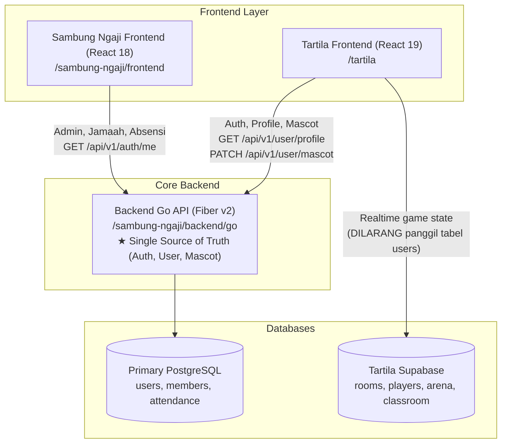

# Tartila

Aplikasi web edukasi mengaji untuk anak (Tilawati interaktif, kuis, arena multiplayer, dan mini-game islami) dengan panel admin, ruang kelas virtual, dan kamar maskot interaktif.

- **Stack:** React 19 + TypeScript + Vite 8, React Router 6, Tailwind CSS 4
- **Animasi/3D/Game:** Framer Motion, Three.js (`@react-three/fiber`/`drei`), Phaser, Lottie
- **State Management:** Zustand (dengan middleware `persist`) + React Context (AuthContext & ThemeContext)
- **Backend Single Source of Truth:** Go Backend (Sambung Ngaji) di `../sambung-ngaji/backend/go`
- **Realtime & Game State Database:** Supabase (Arena, Classroom, Room, Player progress)
- **PWA:** `vite-plugin-pwa` (service worker, auto-update)

---

## 🏛️ Arsitektur & Relasi Ekosistem

Tartila adalah frontend klien khusus edukasi anak yang tergabung dalam ekosistem **Sabil**:



> [!IMPORTANT]
> **Aturan Single Source of Truth**:
> 1. Data User (identitas, profil, kredensial, dan preferensi maskot) tersimpan **eksklusif** di Backend Go.
> 2. Frontend Tartila **DILARANG** melakukan query tabel `users` via Supabase Client (misal: `supabase.from('users')`).
> 3. Integrasi user dan preferensi maskot wajib melalui `src/services/userApi.ts`.

---

## 🐥 Sistem Maskot (Tito & Tila)

Tartila memiliki dua karakter maskot ramah anak:
1. **Tito (Putra)** — Karakter anak laki-laki (`gender: 'boy'`).
2. **Tila (Putri)** — Karakter anak perempuan (`gender: 'girl'`).

### Prinsip Penamaan & UI
> [!CAUTION]
> **DILARANG MENGGUNAKAN ISTILAH BIOLOGIS** seperti *"jantan"* atau *"betina"* di seluruh antarmuka (UI), kode, maupun pesan pengguna! Selalu gunakan istilah ramah anak: **Putra** dan **Putri**, atau nama langsung **Tito** dan **Tila**.

### Alur Sinkronisasi & Persistensi Data
1. **Persistensi Zustand**: State maskot disimpan di Zustand store `useEconomyStore.ts` menggunakan middleware `persist` (`localStorage['tartila-economy-storage']`). Ini menjamin maskot tidak berkedip atau berubah gender saat halaman di-refresh.
2. **Sinkronisasi Awal (App Hydration)**:
   - Pada saat inisialisasi di `AuthContext.tsx`, aplikasi memanggil `getUserProfile()` dari `src/services/userApi.ts`.
   - Mengambil `mascot_gender` dari respon backend Go, kemudian meng-hydrate store:
     ```ts
     useEconomyStore.setState({ tilaGender: profile.mascot_gender });
     ```
3. **Kamar Maskot & Optimistic Update**:
   - Di `src/pages/KamarTilaPage.tsx`, saat pengguna memilih Tito atau Tila, dilakukan **Optimistic Update**:
     - State Zustand langsung diperbarui seketika agar antarmuka responsif tanpa jeda.
     - Memanggil `updateUserMascot(gender)` (`PATCH /api/v1/user/mascot`) ke Backend Go.
     - Jika request gagal, state otomatis di-rollback ke pilihan sebelumnya dan memunculkan toast error.
4. **Dynamic Component Props**:
   - Komponen maskot (`TilaCompanion`, `TilaMascot`) membaca gender secara reaktif dari `useEconomyStore` melalui `resolveMascotGender()` dan `getMascotName()` di `src/utils/mascotHelper.ts`.
   - Dilarang memberikan hardcoded `gender="boy"` atau `gender="girl"` kecuali untuk kartu pratinjau statis di halaman seleksi Kamar Maskot.

---

## Prasyarat

- **Node.js 20+** (disarankan 22 LTS) dan **npm**.
- **Backend Go Sambung Ngaji** berjalan di `http://127.0.0.1:8080` (opsional untuk pengembangan tampilan murni).

---

## Menjalankan di Lokal

```bash
# 1. Install dependensi
npm install

# 2. Siapkan file konfigurasi environment
cp .env.example .env.local
# Pastikan VITE_API_BASE_URL mengarah ke backend Go

# 3. Jalankan Vite dev server (HMR)
npm run dev
# → http://localhost:5173
```

### Halaman Penting

| Path | Keterangan |
| ---- | ---------- |
| `/login` | Halaman login (integrasi Backend Go) |
| `/admin` | Dashboard admin |
| `/member/ngaji-ceria` | Beranda belajar anak (Tilawati & mini-games) |
| `/member/kamar-tila` | Kamar Maskot (ganti Tito/Tila & aksesori) |
| `/member/ngaji-ceria/quiz` | Daftar & alur kuis interaktif |
| `/member/classroom` | Ruang kelas & tugas tilawati |
| `/member/arena` | Tartila Arena multiplayer |
| `/member/ngaji-ceria/cek-audio/timeline` | Editor timeline audio Tilawati |

---

## Scripts

| Perintah | Fungsi |
| -------- | ------ |
| `npm run dev` | Menjalankan Vite dev server |
| `npm run build` | Type-check (`tsc -b`) dan build produksi ke `dist/` |
| `npm run preview` | Menjalankan hasil build `dist/` lokal di `http://localhost:4173` |
| `npm run lint` | Menjalankan linting (Oxlint) |
| `npm test` | Menjalankan suite pengujian Playwright |

---

## Environment Variables

Semua variabel wajib diawali dengan `VITE_` agar dapat diakses di browser. **Jangan menyimpan rahasia/private key di sini.**

| Variabel | Wajib | Deskripsi |
| -------- | ----- | --------- |
| `VITE_API_BASE_URL` | Ya (untuk API) | Base URL REST API Backend Go (contoh: `http://127.0.0.1:8080`). Kosong = fallback origin lokal. |
| `VITE_SUPABASE_URL` | Ya | Endpoint project Supabase Tartila (untuk realtime game, arena, classroom). |
| `VITE_SUPABASE_ANON_KEY` | Ya | Public Anonymous Key Supabase Tartila. |
| `VITE_GOOGLE_CLIENT_ID` | Tidak | Web Client ID Google Cloud OAuth jika menggunakan login Google. |
| `VITE_COLYSEUS_URL` | Tidak | Server multiplayer arena Colyseus (jika diaktifkan). |
| `VITE_NGAJI_CERIA_PLAYER_MODEL` | Tidak | URL model 3D pemain (`.glb`). |

---

## 🗄️ Supabase Migrations & CI/CD

Skema database untuk fitur realtime Tartila dikelola di dalam folder `supabase/migrations/`.

### Struktur Migrasi
- `supabase/migrations/20261022055459_add_game_economy_columns.sql`
- `supabase/migrations/20261022061537_add_ustadz_room_system.sql`
- `supabase/migrations/20261022180000_create_tartila_arena_schema.sql`
- `supabase/migrations/20261023100000_create_classroom_tables.sql`

> [!WARNING]
> **Aturan Skema Supabase Tartila**:
> - Dilarang membuat perintah `CREATE TABLE users` atau `CREATE TABLE auth.users`.
> - Relasi pengguna pada tabel game (seperti `user_id`) wajib berupa tipe `TEXT` atau `UUID` yang mereferensikan id user dari Backend Go.
> - Setiap policy RLS harus idempoten (`DROP POLICY IF EXISTS`).

### Otomasi CI/CD (GitHub Actions)
File workflow di `.github/workflows/supabase-migrate.yml` otomatis berjalan saat branch `main` menerima push:
1. Memeriksa migrasi baru.
2. Menginstal Supabase CLI (`supabase/setup-cli@v1`).
3. Menautkan ke project Supabase (`supabase link`).
4. Menjalankan migrasi database (`supabase db push`).

Secrets yang dibutuhkan di repository GitHub:
- `SUPABASE_ACCESS_TOKEN`: Token personal access Supabase CLI.
- `SUPABASE_PROJECT_REF`: Reference ID project Supabase Tartila.
- `SUPABASE_DB_PASSWORD`: Kata sandi basis data PostgreSQL Supabase.

---

## Struktur Folder

```
src/
├── components/          # Komponen UI bersama
│   ├── mascot/          # TilaMascot, TilaCompanion, aksesoris
│   ├── classroom/       # Komponen ruang kelas
│   └── ui/              # Button, Modal, Card, FontAwesomeIcons
├── contexts/            # AuthContext (sinkronisasi Go API), ThemeContext
├── features/
│   ├── admin/           # Panel admin pengajar & konten
│   ├── auth/            # Halaman & form login
│   └── ngaji-ceria/     # Modul belajar anak (Tilawati, kuis, game)
├── hooks/               # Custom hooks
├── pages/               # Halaman rute aplikasi (lazy loaded)
├── services/
│   ├── api.ts           # REST API client umum
│   ├── userApi.ts       # Endpoint profil & maskot ke Backend Go
│   ├── supabase.ts      # Supabase client (game/classroom only)
│   └── classroomApi.ts  # API interaksi ruang kelas
├── stores/              # Zustand stores (useEconomyStore dengan persist)
├── types/               # Type definitions TypeScript
└── utils/               # mascotHelper, audioHelper, formatters
```

---

## 🤖 Panduan untuk AI Agent (AI Agent Guidelines)

Jika Anda adalah AI Agent (seperti Claude, GPT, Antigravity, Copilot, atau Cursor) yang mengerjakan repositori ini, patuhi aturan mutlak berikut:

### 1. Batasan Direktori yang Sangat Ketat (Strict Boundaries)
- **HANYA TULIS KODE FRONTEND DI SINI**: Repositori ini murni aplikasi React/TypeScript.
- **DILARANG MEMBUAT FILE BACKEND**: Dilarang membuat file `.go` atau modul Go di folder `/tartila`.
- **JANGAN JALANKAN PERINTAH GO**: Jangan pernah menjalankan `go run`, `go test`, atau `go mod tidy` di repositori ini.
- Untuk perubahan backend, arahkan ke repositori Backend Go di `../sambung-ngaji/backend/go`.

### 2. Aturan Data User & Database
- **DILARANG QUERY TABEL USERS VIA SUPABASE**:
  - ❌ `supabase.from('users').select(...)`
  - ❌ `supabase.from('users').update(...)`
  - ✅ Gunakan `src/services/userApi.ts` yang memanggil Backend Go:
    - `getUserProfile()` -> `GET /api/v1/user/profile`
    - `updateUserMascot(gender)` -> `PATCH /api/v1/user/mascot`

### 3. Aturan Maskot (Tito & Tila)
- **Karakter**: Tito = Putra (`'boy'`), Tila = Putri (`'girl'`).
- **Hindari Istilah Biologis**: Dilarang keras memakai istilah `"jantan"` atau `"betina"`.
- **Persistensi State**: State maskot tersimpan di `useEconomyStore.ts` dengan key `tilaGender`.
- **Komponen**: Jangan hardcode `gender="boy"` atau `gender="girl"` pada `<TilaCompanion />` atau `<TilaMascot />`. Biarkan komponen membaca state dinamis dari store melalui `src/utils/mascotHelper.ts`.
- **Optimistic UI**: Pembaruan maskot di `KamarTilaPage.tsx` harus menggunakan pembaruan optimistik dengan mekanisme fallback jika API gagal.

### 4. Aturan Skema Migrasi Supabase
- File migrasi berada di `supabase/migrations/`.
- Jangan pernah menyertakan `CREATE TABLE users` atau alter skema `auth.users` di sini.
- Selalu gunakan sintaks PostgreSQL murni (bukan sintaks MySQL seperti inline `COMMENT '...'`).
- Buat policy RLS yang idempoten (`DROP POLICY IF EXISTS ... ON ...`).

### 5. Verifikasi Wajib Sebelum Menyelesaikan Tugas
Sebelum menyatakan pekerjaan selesai atau melakukan commit, jalankan:
```bash
npm run build
npm test
```
Pastikan seluruh type-checking TypeScript dan unit test lulus tanpa error.
